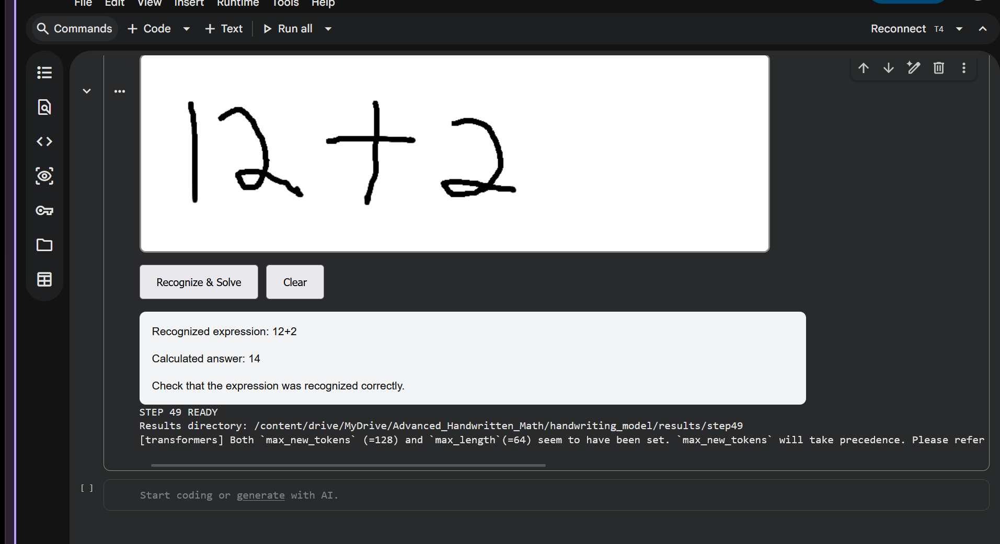

# Advanced Mathematical Vision AI

**Handwritten Mathematical Expression Recognition and Arithmetic Solving Using Deep Learning**

Advanced Mathematical Vision AI is a Python-based application designed to recognise handwritten mathematical expressions and calculate their results.

The system combines a pretrained handwriting recognition model, image preprocessing, and a mathematical expression evaluator. Users can write mathematical expressions on a digital canvas, submit them for recognition, and view the calculated results.

The project was developed and tested using Python, PyTorch, Hugging Face Transformers, and Google Colab.

## Features

- Interactive canvas for writing mathematical expressions.
- Handwriting recognition using a pretrained TrOCR model.
- Image preprocessing to improve recognition input.
- Automatic calculation of supported arithmetic expressions.
- Display of recognised expressions and their calculated results.
- Support for addition, subtraction, multiplication, division, parentheses, and exponentiation.
- GPU acceleration when compatible hardware is available.

## Handwriting Recognition Demonstration

The following screenshot shows the system recognising a handwritten mathematical expression and calculating its result.



**Example result**

| Description | Result |
|---|---|
| Handwritten input | `12 + 2` |
| Recognised expression | `12+2` |
| Calculated answer | `14` |
| Recognition status | Successful for this example |

The screenshot was captured during testing in Google Colab using the interactive handwriting canvas.

## Technologies Used

| Technology | Purpose |
|---|---|
| Python | Application development |
| PyTorch | Deep learning model execution |
| Hugging Face Transformers | Loading and running the pretrained recognition model |
| TrOCR | Handwritten expression recognition |
| Pillow | Image processing |
| NumPy | Image manipulation |
| Google Colab | Development and experimentation |
| NVIDIA Tesla T4 | GPU-accelerated model inference |
| GitHub | Source code management |

## Recognition Model

The current recognition component uses the publicly available [us4/trocr-mathwriting](https://huggingface.co/us4/trocr-mathwriting) checkpoint.

This model was selected after experimenting with other approaches to mathematical handwriting recognition.

The application uses the pretrained model for inference. The model weights are downloaded separately from Hugging Face and are not included in this repository.

## How the System Works

The recognition and calculation process follows five stages:

1. **Handwriting input:** The user writes an expression on the digital canvas.
2. **Image preprocessing:** The drawing is cropped and prepared for recognition.
3. **Expression recognition:** The pretrained TrOCR model converts the handwritten image into text.
4. **Mathematical evaluation:** The recognised arithmetic expression is passed to a restricted mathematical evaluator.
5. **Result display:** The application presents the recognised expression and calculated answer.

For example:

**Handwritten expression:** `20 - 3`

**Recognised expression:** `20-3`

**Calculated result:** `17`

## Project Structure

```text
Advanced-Mathematical-Vision-Ai/
│
├── app.py
├── recognition.py
├── preprocessing.py
├── math_solver.py
├── requirements.txt
├── README.md
├── .gitignore
│
└── screenshot/
    └── handwriting_image.png
```

**Main project files**

- `app.py` — Application interface and handwriting input workflow.
- `recognition.py` — Pretrained model loading and handwriting recognition.
- `preprocessing.py` — Image cropping, padding, and preprocessing.
- `math_solver.py` — Restricted arithmetic expression evaluation.
- `requirements.txt` — Python dependencies.
- `screenshot/` — Demonstration images captured during testing.

## Installation and Setup

Python 3.10 or newer is recommended. A GPU can improve model inference performance, but CPU execution is also possible.

### 1. Clone the repository

```bash
git clone https://github.com/MCK-5/Advanced-Mathematical-Vision-Ai.git
cd Advanced-Mathematical-Vision-Ai
```

### 2. Create a virtual environment

```bash
python -m venv .venv
```

Activate the environment.

**Windows:**

```bash
.venv\Scripts\activate
```

**Linux/macOS:**

```bash
source .venv/bin/activate
```

### 3. Install dependencies

```bash
pip install -r requirements.txt
```

### 4. Run the application

```bash
python app.py
```

The application starts the handwriting recognition interface.

**Note:** The first execution downloads the pretrained model from Hugging Face. The model weights are approximately 2.1 GB, so sufficient internet connectivity and storage are required.

## Development Background

The project was developed through several experimental stages.

### Phase 1 — Mathematical Symbol Classification

The initial system used the HASYv2 dataset containing 369 mathematical symbol classes.

A convolutional neural network was trained to classify individual handwritten mathematical symbols.

The resulting model achieved approximately **82.41% test accuracy on the HASYv2 test set**.

However, recognising individual symbols did not provide sufficiently reliable recognition of complete handwritten expressions.

### Phase 2 — Mathematical Expression Recognition

The project subsequently explored pix2tex, a pretrained mathematical expression recognition system.

Although pix2tex successfully recognised some printed mathematical expressions, its performance on handwritten expressions was inconsistent during testing.

### Phase 3 — Handwriting-Specific Recognition

The project then adopted the pretrained `us4/trocr-mathwriting` model.

This provided improved recognition on some handwritten arithmetic expressions, including the successful examples shown in the project demonstrations.

### Phase 4 — Recognition and Calculation Integration

The handwriting recognition model was integrated with an arithmetic evaluator.

This enabled the system to recognise handwritten expressions and calculate supported arithmetic results through a single interface.

## Testing

The system has been tested with handwritten arithmetic expressions drawn in Google Colab.

Examples include:

| Expression | Expected answer |
|---|---|
| `12+2` | 14 |
| `20-3` | 17 |
| `7*4` | 28 |
| `18/3` | 6 |
| `(5+3)*2` | 16 |
| `2^3` | 8 |

These examples describe supported arithmetic operations and their expected results. They do not represent a measured overall recognition accuracy.

To run the project's unit tests when the `tests/` directory is available:

```bash
python -m unittest discover -s tests -v
```

## Current Limitations

The application is still under development.

- Recognition accuracy depends on handwriting style, symbol clarity, and image quality.
- Some handwritten digits and symbols may be confused with similar characters.
- The mathematical evaluator currently focuses on numeric arithmetic expressions.
- Algebraic equations, integrals, advanced symbolic mathematics, and full LaTeX interpretation are not yet supported by the solver.
- Recognition performance has not yet been established through a comprehensive independent handwritten-expression benchmark.

Users should verify the recognised expression before relying on a calculated answer.

## Future Improvements

Planned improvements include:

- Fine-tuning on additional handwritten mathematical expressions.
- Improving recognition of similar-looking digits and mathematical symbols.
- Supporting fractions, roots, exponents, and more complex mathematical notation.
- Extending the solver to algebraic and symbolic mathematics.
- Adding mathematical expression rendering.
- Measuring recognition accuracy using a dedicated evaluation dataset.
- Developing a more accessible web-based interface.

## Model Attribution

This project uses the pretrained [us4/trocr-mathwriting](https://huggingface.co/us4/trocr-mathwriting) checkpoint.

The pretrained model belongs to its original authors and contributors. Its model card and applicable licensing terms should be reviewed before redistribution or commercial use.

The repository does not redistribute the pretrained model weights.

## Author

**MCK-5**

GitHub: [github.com/MCK-5](https://github.com/MCK-5)

## Project Status

**Active development**

The current version demonstrates handwritten arithmetic expression recognition and calculation. Further development will focus on recognition reliability and support for more advanced mathematics.
